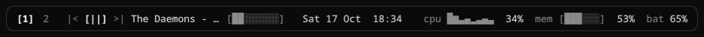
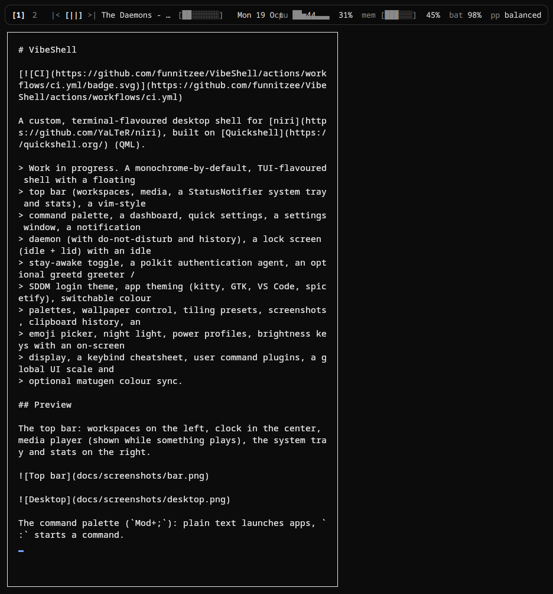
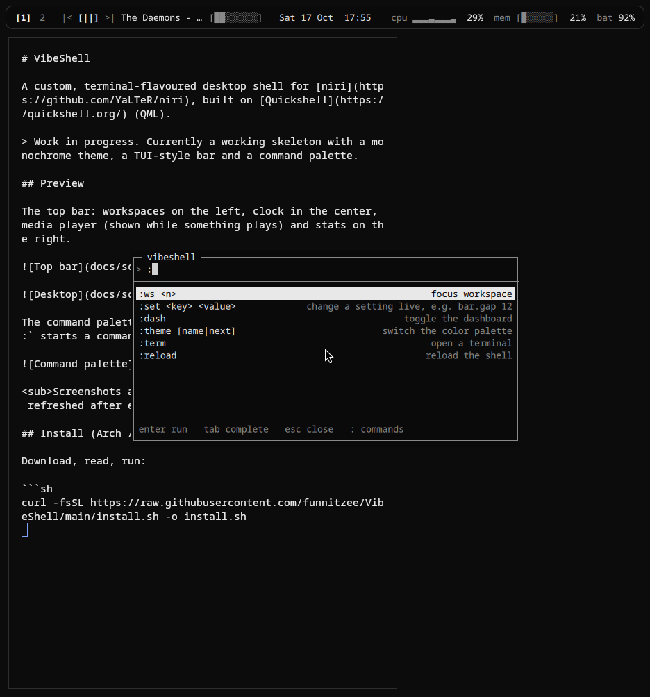
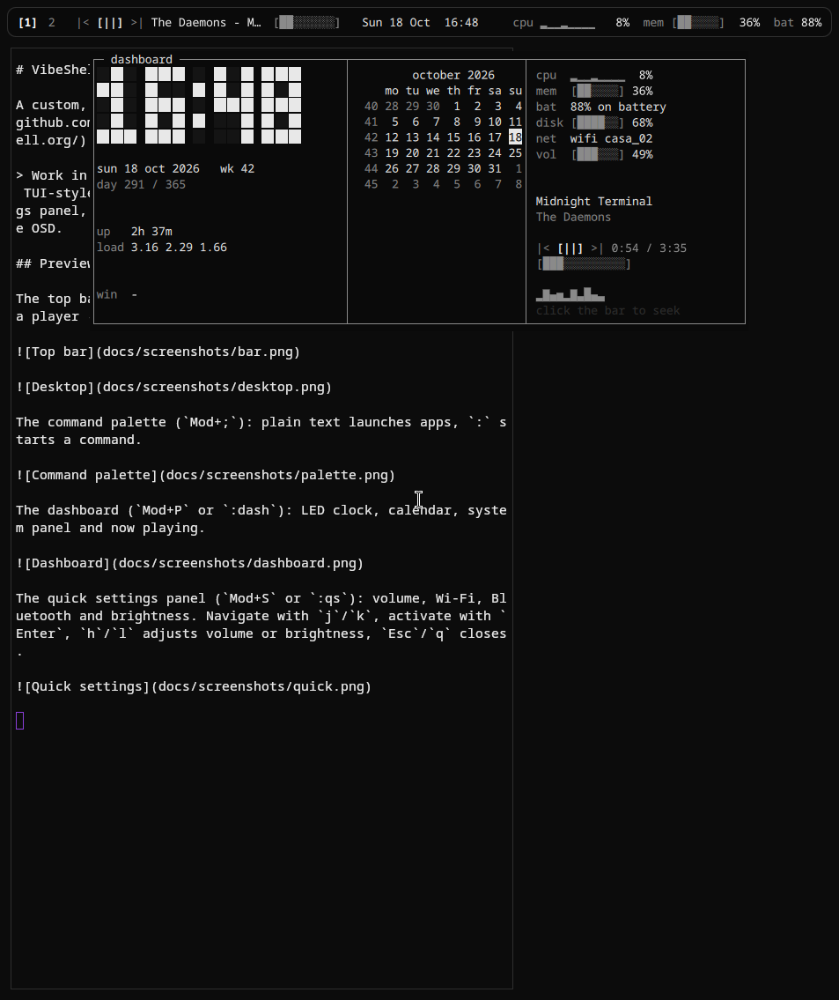
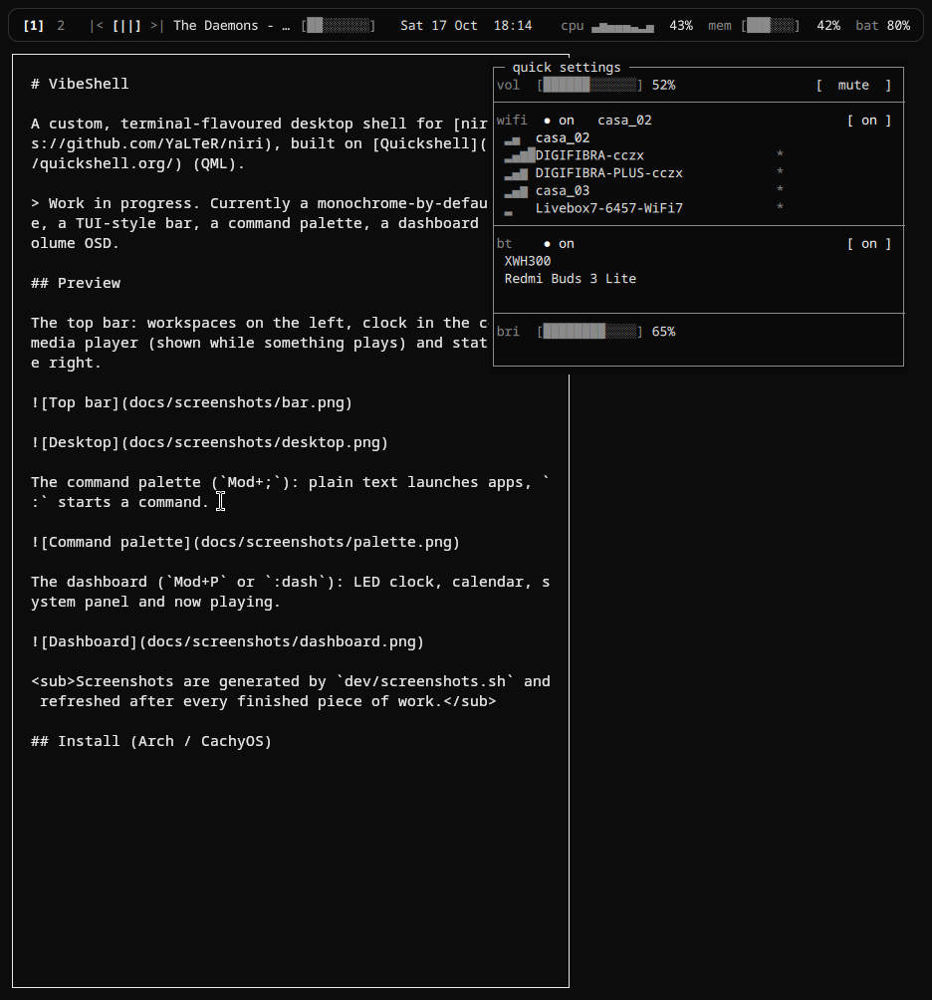
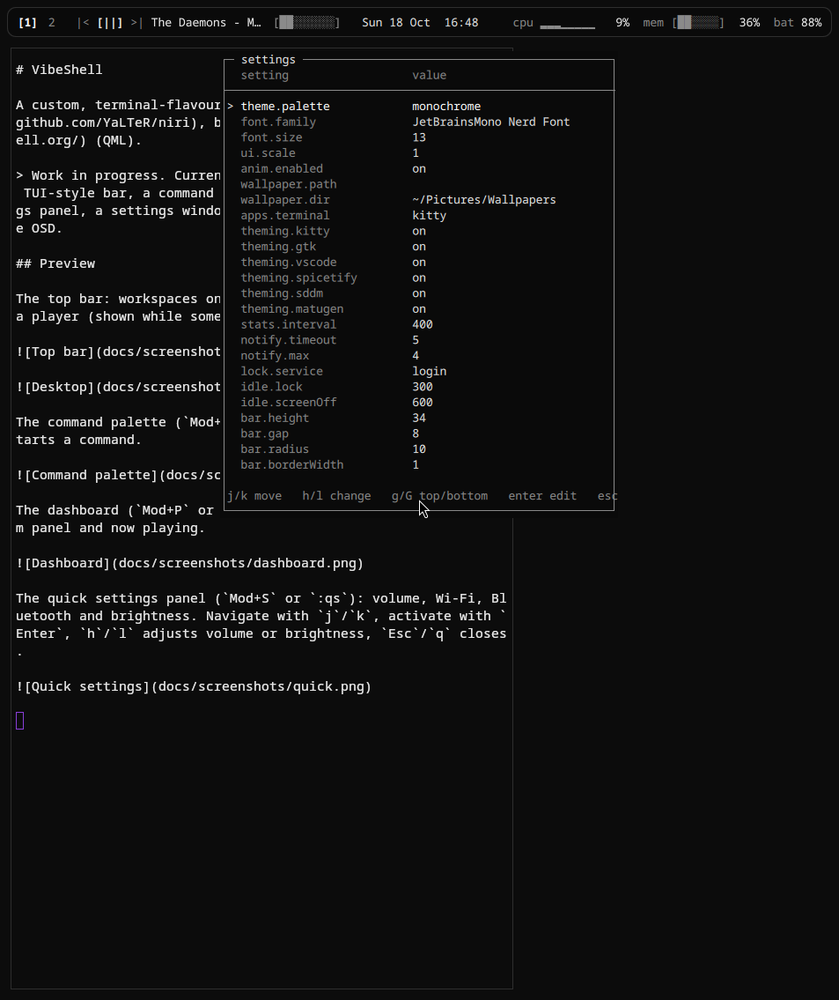
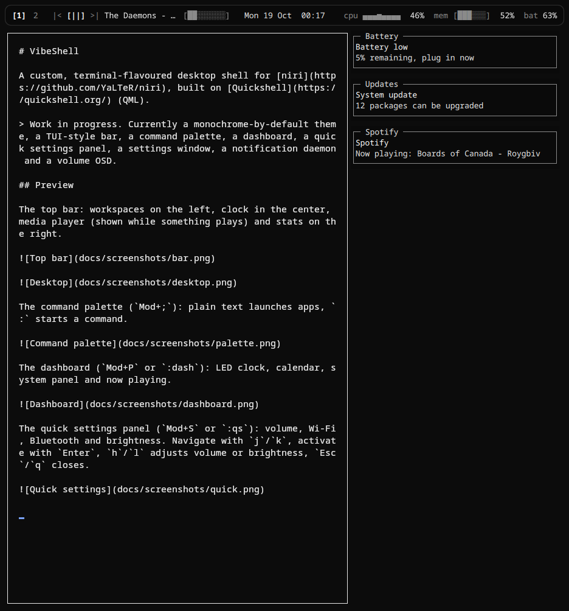

# VibeShell

[](https://github.com/funnitzee/VibeShell/actions/workflows/ci.yml)

A custom, terminal-flavoured desktop shell for [niri](https://github.com/YaLTeR/niri), built on [Quickshell](https://quickshell.org/) (QML).

> Work in progress. A monochrome-by-default, TUI-flavoured shell with a floating
> top bar (workspaces, media, a StatusNotifier system tray and stats), a vim-style
> command palette, a dashboard, quick settings, a settings window, a notification
> daemon (with do-not-disturb and history), a lock screen (idle + lid) with an idle
> stay-awake toggle, a polkit authentication agent, an optional greetd greeter /
> SDDM login theme, app theming (kitty, GTK, VS Code, spicetify), switchable colour
> palettes, wallpaper control, tiling presets, screenshots, clipboard history, an
> emoji picker, night light, power profiles, brightness keys with an on-screen
> display, a keybind cheatsheet, user command plugins, a global UI scale and
> optional matugen colour sync.

## Preview

The top bar: workspaces on the left, clock in the center, media player (shown while something plays), the system tray and stats on the right.





The command palette (`Mod+;`): plain text launches apps, `:` starts a command.



The dashboard (`Mod+P` or `:dash`): LED clock, calendar, system panel and now playing.



The quick settings panel (`Mod+S` or `:qs`): volume, Wi-Fi, Bluetooth, brightness, night light, power profile and an idle stay-awake toggle. Navigate with `j`/`k`, activate with `Enter`, `h`/`l` adjusts volume or brightness, `Esc`/`q` closes.



The settings window (`Mod+Shift+S` or `:settings`): every setting from `defaults`, edited in place.



Notifications: VibeShell is the notification daemon, and popups are TUI cards with per-urgency colours.



## Lock screen & idle

- Lock: `Mod+Alt+L`, `:lock`, or `quickshell ipc -p <shell> call lock lock`
  (if your niri config already binds `Mod+Alt+L` elsewhere, the installer's snippet
  skips its own bind and that one stays in charge)
- Lid close: the shell watches `/proc/acpi/button/lid/*/state` and locks as soon as the
  lid is closed (works on any laptop; a no-op on desktops)
- Idle: auto-lock after `idle.lock` seconds, power off monitors after `idle.screenOff` seconds (set to 0 to disable)
- Stay awake: `:awake` (or `idle.stayAwake`) disables both idle timers entirely, for watching something long
- PAM: uses `lock.service` (defaults to `login`); set `VIBESHELL_PAM_DIR` to test custom PAM configs
- Note: while locked, niri blocks screen capture

## Greeter

TUI greeter integrated with greetd: username + password prompt, PAM-driven via Greetd. Shown automatically when running under greetd; can be tested in sandbox by starting the greeter service.

`install.sh --greeter` installs `greetd` and sets it up: the shell is copied to
`/usr/local/share/vibeshell/shell` (the greeter runs as the unprivileged `greeter`
user, which must be able to read it), a minimal niri session
(`/etc/greetd/vibeshell-greeter.kdl`) is written to start it, and
`/etc/greetd/config.toml` points greetd at that session. It offers to disable your
current display manager (SDDM/GDM/LightDM/ly) and enable greetd; every file is
backed up first. The greeter screen takes over as soon as the shell starts under
greetd (`GREETD_SOCK` is set). Re-run `--greeter` after updating the shell to
refresh the `/usr/local/share/vibeshell` copy the greeter reads.

<sub>Screenshots are generated by `dev/screenshots.sh` and refreshed after every finished piece of work.</sub>

## App theming

The shell derives app themes from the active palette and regenerates them on every
palette change. Files land in `~/.config/vibeshell/app-themes/`:

| App | File | How it is wired |
|---|---|---|
| kitty | `kitty/kitty-theme.conf` | `include` line in `kitty.conf` (a full config: font, padding, cursor, scrollback and colours) |
| GTK 3 / 4 | `gtk/gtk.css` | `@import` in `gtk-3.0/gtk.css` and `gtk-4.0/gtk.css` |
| VS Code | `vscode/` | symlink into `~/.vscode/extensions/vibeshell-theme` |
| spicetify | `spicetify/` | symlink into `~/.config/spicetify/Themes/VibeShell` |
| SDDM | `sddm/theme.conf` | `install.sh --sddm` copies the theme into `/usr/share/sddm/themes/vibeshell` |

Run `install.sh --apps` to add the include lines and symlinks (each file is backed
up first). Toggle per-app generation in `settings.json` under `theming`
(`kitty`, `gtk`, `vscode`, `spicetify`, `sddm`, `matugen`), or regenerate manually
with `:theming`.

With `theming.matugen` enabled (the default), every palette change also pushes the
accent into [matugen](https://github.com/InioX/matugen) (`matugen color hex <accent>`),
so anything you have matugen generating from follows the shell too. Run it by hand
with `:matugen`.

### SDDM login theme

`install.sh --sddm` installs a terminal-styled SDDM theme (`sddm/vibeshell/`) and
selects it in `/etc/sddm.conf.d/vibeshell.conf`. The colours come from the live
`app-themes/sddm/theme.conf` the shell generates, so the login screen matches the
palette.

## Install (Arch / CachyOS)

Download, read, run:

```sh
curl -fsSL https://raw.githubusercontent.com/funnitzee/VibeShell/main/install.sh -o install.sh
less install.sh
bash install.sh --niri
```

Or, if you trust this repo:

```sh
curl -fsSL https://raw.githubusercontent.com/funnitzee/VibeShell/main/install.sh | bash -s -- --niri
```

Combine the flags you want. A full setup (app themes, SDDM login theme, a lone-Super
palette key and a verbose boot) is:

```sh
bash install.sh --niri --apps --sddm --super-tap --no-plymouth
```

`--greeter` is the greetd alternative to `--sddm` — use one or the other. The same
flags work with the one-liner, e.g.:

```sh
curl -fsSL https://raw.githubusercontent.com/funnitzee/VibeShell/main/install.sh | bash -s -- --niri --apps --super-tap
```

Run `bash install.sh` with no flags for the guided installer: it walks you through
picking a profile (`minimal`, `balanced` adds the optional tools, or `full` also sets
up a login manager), shows a summary, and only then touches your system. It asks before
running `sudo pacman`, backs up every file it overwrites (`<file>.bak.<timestamp>`), and
can be re-run safely. Without `--niri` it only writes `~/.config/niri/vibeshell.kdl` and
tells you which `include` line to add. It also installs the `vibeshell` CLI to
`~/.local/bin` and creates `~/.config/vibeshell/commands/` with an example plugin.

The full flag list:

| Flag | What it does |
|---|---|
| `--niri` | add `include "vibeshell.kdl"` to your `config.kdl` (backed up first) |
| `--apps` | wire kitty/GTK includes and the VS Code/spicetify symlinks |
| `--sddm` | install the VibeShell SDDM theme and select it |
| `--greeter` | install greetd and configure the niri/VibeShell greeter |
| `--super-tap` | install keyd so a lone Super key opens the palette (see below) |
| `--no-plymouth` | remove plymouth and the silent boot (`quiet`/`splash`, `loglevel=6`) |
| `--no-packages` | skip the `pacman` step |
| `-y`, `--yes` | never ask for confirmation |

The base `pacman` step installs everything the shell talks to:
`niri`, `quickshell`, `ttf-jetbrains-mono-nerd`, `kitty`, `brightnessctl`,
`swaybg`, `wireplumber` (`wpctl` for the volume keys/OSD), `networkmanager`
(the Wi-Fi panel), `bluez` (the Bluetooth panel), `upower` (the battery readout)
and `matugen` (colour sync). The `brightnessctl` package drives the brightness
keys and their OSD. The display managers/aids are only pulled in by their
flags: `sddm` (`--sddm`), `greetd` (`--greeter`) and `keyd` (`--super-tap`).
Installing a package does not start its daemon, so the installer prints a hint if
`NetworkManager`, `bluetooth` or `upower` are not running. The `balanced`/`full`
profiles add the optional tools the shell can use: `grim`, `slurp`, `wl-clipboard`,
`cliphist`, `libnotify`, `gammastep`, `power-profiles-daemon` and `swappy`.

When writing `vibeshell.kdl`, the installer skips any bind whose key is already
bound elsewhere in your niri config (dms, `config.kdl`, ...), because niri refuses
to load a config with duplicate keybinds.

Try it without restarting niri: `quickshell -p ~/.local/share/vibeshell/shell`

### Open the palette with a lone Super key

niri cannot bind a bare modifier (`Mod` on its own) — a `Mod+X` bind fires for every
`Mod+X`, and there is no "prefix only" bind. So `install.sh --super-tap` uses
[keyd](https://github.com/rvaiya/keyd) to turn a lone left Super into `F15`:

```
leftmeta = overload(meta, f15)
```

Holding Super still acts as `Mod` (so `Mod+Return` etc. keep working); tapping it
sends `F15`, which the niri snippet binds to the palette. `Mod+;` stays bound as a
fallback. The rule lives in `/etc/keyd/default.conf`.

## Tiling presets

The command palette exposes niri's actions:

| Command | What it does |
|---|---|
| `:tile <preset>` | `wide` (70%), `narrow` (30%), `mono` (100%), `normal` (50%), `center`, `float`, `max` |
| `:niri <action> [args]` | run any niri action, e.g. `:niri consume-or-expel-window-right`, `:niri focus-monitor-left` |

So `:niri <action>` is a full escape hatch to niri's whole action list.

## Wallpaper

Install `swaybg` (or `swww`) and the shell manages the wallpaper for you:

| Command | What it does |
|---|---|
| `:wallpaper` / `:wallpaper next` | next image in `wallpaper.dir` |
| `:wallpaper prev` | previous image |
| `:wallpaper <path>` | set a specific image |

The current image is saved to `wallpaper.path` and restored on startup. `wallpaper.dir`
(default `~/Pictures/Wallpapers`) is scanned for `.jpg/.jpeg/.png/.webp`.

## Touchpad gestures

Workspace switching and horizontal scrolling are handled by niri itself, not the
shell: three-finger vertical swipes switch workspaces and three-finger horizontal
swipes move the view between windows (four-finger vertical opens the overview). They
are on by default on niri 25.05+, so there is nothing to configure in VibeShell.

## UI scale & animations

- `ui.scale` (default `1.0`) multiplies the font **and** every pixel constant (bar
  height, gaps, radius, borders), so the whole shell — not just text — scales. Set it
  in the settings window, with `:scale 1.25`, or `:set ui.scale 1.25`.
- `anim.enabled` (default `true`) toggles the shell's animations (blinking cursors,
  the equalizer). Toggle with `:anim` or `:set anim.enabled false`.

## Command palette

Press `Mod+;` (bound by the installer's niri snippet). Type to search applications, or start with `:` for commands:

| Command | What it does |
|---|---|
| `:ws <n>` | focus workspace n |
| `:set <key> <value>` | change a setting live and save it, e.g. `:set bar.gap 12` |
| `:calc <expression>` | evaluate arithmetic, e.g. `:calc (2+3)*4` |
| `:term` | open a terminal |
| `:reload` | reload the shell |
| `:dash` | open the dashboard |
| `:qs` | open the quick settings panel |
| `:settings` | open the settings window |
| `:notify [dnd\|history\|clear]` | dismiss all, toggle do-not-disturb, or browse history |
| `:power [profile [name]]` | lock/suspend/logout/reboot/shutdown, or pick a CPU profile |
| `:night [on\|off\|warmer\|cooler\|<kelvin>]` | night light (warmer screen colours) |
| `:shot [full\|region\|edit\|region-edit]` | screenshot to `~/Pictures/Screenshots` + clipboard (`edit` opens swappy) |
| `:clip [clear]` | clipboard history (needs `cliphist`) |
| `:emoji` | emoji picker (copies to the clipboard) |
| `:keys` | keybind cheatsheet overlay |
| `:lock` | lock the screen |
| `:awake [on\|off]` | keep the screen awake (toggle when no argument) |
| `:theming` | regenerate app theme files under `app-themes/` |
| `:theme [name\|next]` | switch colour palette (`next` cycles) |
| `:wallpaper [next\|prev\|<path>]` | change the wallpaper |
| `:tile <preset>` | tiling preset: `wide`, `narrow`, `mono`, `normal`, `center`, `float`, `max` |
| `:niri <action> [args]` | run any niri action |
| `:anim` | toggle shell animations |
| `:matugen` | sync app colours from the accent via matugen |
| `:scale <n>` | set the UI scale, e.g. `:scale 1.25` |
| `:help` | list every command |

`:night` needs `gammastep` (or `redshift`/`wlsunset`), `:power profile` needs
`power-profiles-daemon`, and `:clip` needs `cliphist` + `wl-clipboard` — all optional.
Commands that return a list (clipboard, emoji, power, help, ...) open the palette in
list mode: type to filter, `Enter` selects, `Esc` goes back.

`Enter` runs, `Tab` completes, `Up`/`Down` (or `Ctrl+P`/`Ctrl+N`) move, `Esc` closes.
It can also be driven from a script: `quickshell ipc -p <shell dir> call palette open ":"`
or `... call palette run ":ws 2"`.

## Settings

User settings live in `~/.config/vibeshell/settings.json` and override
`shell/defaults/settings.json`. The shell reloads on every save.

The settings window (`Mod+Shift+S`, `:settings`, or `... call settings toggle`)
lists every key below and edits it in place: `j`/`k` move, `h`/`l` (or arrows)
change values and cycle the palette, `g`/`G` jump to the top/bottom, `Enter`/`e`
types a value, `Esc`/`q` closes.

```json
{
  "theme": { "palette": "monochrome" },
  "font": { "family": "JetBrainsMono Nerd Font", "size": 13 },
  "ui": { "scale": 1.0 },
  "anim": { "enabled": true },
  "wallpaper": { "path": "", "dir": "~/Pictures/Wallpapers" },
  "apps": { "terminal": "kitty" },
  "theming": { "kitty": true, "gtk": true, "vscode": true, "spicetify": true, "sddm": true, "matugen": true },
  "stats": { "interval": 2000 },
  "notify": { "timeout": 5, "max": 4, "dnd": false, "historyMax": 50 },
  "night": { "enabled": false, "temperature": 4500 },
  "power": { "lowThreshold": 15 },
  "lock": { "service": "login" },
  "idle": { "lock": 300, "screenOff": 600, "stayAwake": false },
  "bar": { "height": 34, "gap": 8, "radius": 10, "borderWidth": 1 }
}
```

Palettes are JSON files in `shell/palettes/`: `monochrome`, `catppuccin-mocha`,
`tokyo-night`, `rose-pine`, `nord`, `dracula` and `kanagawa`. Switch at runtime with
`:theme <name>` (or cycle with `:theme next`); the choice is saved to `settings.json`.

## Notifications

VibeShell owns `org.freedesktop.Notifications`, so it replaces a standalone daemon
like dunst or mako — don't run one alongside it, or they'll fight over the bus name.
Popups stack in the top-right corner as TUI cards: the app name in the frame title,
the summary, the body and any action shortcuts. Critical notifications stay until
dismissed, the rest time out (`notify.timeout` seconds, or the app's own timeout);
at most `notify.max` are shown at once. Click a card to dismiss it, or run `:notify`
(or `... call notify clear`) to clear the stack. Test it with `notify-send "hi"`.

Do Not Disturb (`:notify dnd`, or `... call notify dnd`) hides the popups while still
recording a rolling history (`notify.historyMax` entries); browse it with
`:notify history`. The state persists in `notify.dnd`.

## Night light & power profiles

Two optional, panel-friendly extras that show up in quick settings (`Mod+S`) and the
bar when their tools are installed:

- **Night light** (`:night`): warmer screen colours via `gammastep`, `redshift` or
  `wlsunset`. `:night on`/`off` toggles it, `:night warmer`/`cooler` nudges the
  temperature, `:night 3500` sets it directly. State lives in `night.enabled` /
  `night.temperature` and is restored on startup.
- **Power profiles** (`:power profile`, or `:power profile performance`):
  `power-profiles-daemon`'s `power-saver` / `balanced` / `performance` from
  `powerprofilesctl`. The quick settings row cycles them with `Enter`/`h`/`l`.

## System tray

The bar shows a StatusNotifier (app indicator) tray to the left of the stats: one
text token per item. Left click activates, middle click runs the secondary action, the
wheel scrolls (volume mixers, ...) and a right click opens the item's menu when it has
one. Nothing to configure — it uses the same `StatusNotifierWatcher` as any other
shell, so items simply appear as apps register.

## Authentication agent (polkit)

The shell runs a polkit agent: when a privileged action needs a password, a centered
TUI prompt appears (message, prompt, masked input; `Enter` authenticates, `Esc`
cancels). Only one agent can own a subject at a time, so if you already run one
(gnome-polkit, hyprpolkitagent, ...) VibeShell's stays dormant and the window never
shows — which is why the installer does not pull in a separate agent package.

## CLI and user scripts

Every running shell can be driven from a terminal through the `vibeshell` wrapper
(installed to `~/.local/bin/vibeshell` by `install.sh`, or `/usr/bin/vibeshell` from
the AUR package):

```sh
vibeshell theme tokyo-night     # :theme tokyo-night
vibeshell toggle quick          # open quick settings
vibeshell shot region           # screenshot a region
vibeshell run ":night on"       # any palette command
vibeshell doctor                # check which optional tools are present
```

Drop any executable script into `~/.config/vibeshell/commands/` and it shows up in the
palette as `:name` (a `# desc: ...` line sets its description). It runs detached with
whatever arguments you type after it.

```sh
cat > ~/.config/vibeshell/commands/notes.sh <<'EOF'
#!/usr/bin/env bash
# desc: open my notes
kitty -e nvim ~/notes.md
EOF
chmod +x ~/.config/vibeshell/commands/notes.sh   # then :notes
```

## Install from the AUR

`packaging/` holds a `vibeshell-git` PKGBUILD for a system-wide install (shell in
`/usr/share/vibeshell`, the `vibeshell` CLI in `/usr/bin`):

```sh
cd packaging && makepkg -si
```

The guided `install.sh` remains the recommended path — it also wires niri, app theming
and the greeter. Submitting the PKGBUILD to the AUR only needs a fresh
`makepkg --printsrcinfo > .SRCINFO`.

## Development

`dev/run-nested.sh` runs the shell in a nested niri window with every XDG directory
redirected to `/tmp/vibeshell-dev`, so your real config is never touched.
`dev/run-nested.sh --shot 6` takes a screenshot after 6 seconds and quits.

`dev/screenshots.sh` regenerates the pictures in `docs/screenshots/` (old ones are overwritten).

While the nested window is running, `dev/sbx.sh` talks to the shell inside it
without touching the live session: `dev/sbx.sh call <target> <fn> [args]` for an
IPC call, `dev/sbx.sh restart` to reload just quickshell after a code change,
`dev/sbx.sh status`, and `dev/sbx.sh shot [name]`. Don't `:lock` inside the
sandbox — locking the nested niri disables screenshots and asks your real PAM.

`dev/test.sh` is a self-contained smoke test: it copies the shell into its own
sandbox, starts a nested niri on a private D-Bus session, and checks the command
palette, the panels and a few services over IPC (with the optional tools stubbed
out, so it needs nothing installed). Green run:

```
$ dev/test.sh
palette
  ok    :help lists commands
  ok    :calc adds
  ...
passed 29, failed 0
```

CI runs the same script on every push and pull request
(`.github/workflows/ci.yml`): an Arch Linux container with a headless Weston
acting as the host compositor for the nested niri, so the suite needs no GPU. A
separate `lint` job runs `dev/lint.sh` (syntax check, shellcheck and qmllint) on
the shell and scripts.

Pushing a `v*` tag runs `.github/workflows/release.yml`, which builds
`packaging/PKGBUILD` (pinned to the tag) and attaches the `.pkg.tar.zst` plus a
`.sha256` to a generated GitHub release.

## Layout

```
install.sh   Installer
bin/         vibeshell CLI wrapper
shell/       Quickshell config (entry point: shell/shell.qml)
  bar/       Bar and its modules (workspaces, media, tray, stats)
  dashboard/ Dashboard: clock, calendar, system panel, now playing
  quick/     Quick settings: volume, Wi-Fi, Bluetooth, brightness, night light, power profiles, stay awake
  settings/  Settings window: edit and save any setting in place
  keys/      Keybind cheatsheet overlay
  notify/    Notification popups (TUI cards)
  osd/       On-screen display (volume, night light, power profiles, brightness)
  palette/   Command palette (UI and command backend)
  polkit/    Polkit authentication agent prompt
  components/ Reusable pieces: TuiFrame, Spark, Gauge, Txt, BigClock, Eq
  services/  Singletons: niri, media, audio, network, bluetooth, brightness, power, stats, notifications, wallpaper, screenshot, clipboard, night light, power profiles, app theming, idle
  palettes/  Color palettes
  defaults/  Shipped default settings
sddm/        SDDM login theme (installed with --sddm)
packaging/   AUR PKGBUILD (vibeshell-git)
dev/         Sandbox: nested niri, screenshot generator, smoke tests (dev/test.sh)
docs/        Screenshots used in this README
```

## Roadmap

- [x] Skeleton: settings, theme, top bar (workspaces, clock, media, stats)
- [x] Installer
- [x] TUI building blocks: character-cell frames, sparklines, gauges
- [x] Vim-style command palette (apps + commands)
- [x] Inline calculator in the palette (`:calc`)
- [x] Color palettes, switchable at runtime (`:theme`)
- [x] TUI dashboard: clock, calendar, system panel, now playing
- [x] Volume OSD and media keys
- [x] Quick settings panel: volume, Wi-Fi, Bluetooth, brightness
- [x] Settings window
- [x] Notification daemon and popups
- [x] Lock screen + idle
- [x] Greeter
- [x] App theming (kitty, GTK, VS Code, ...)
- [x] SDDM login theme (`--sddm`)
- [x] Wallpaper control (`:wallpaper`, swaybg/swww)
- [x] Tiling presets and `:niri` action passthrough
- [x] Global UI scale (`ui.scale`) and animation toggle (`:anim`)
- [x] Super-tap palette via keyd (`--super-tap`)
- [x] Lock on lid close
- [x] Optional matugen colour sync (`theming.matugen`)
- [x] Screenshots (`:shot`, grim/slurp) and optional swappy annotation
- [x] Clipboard history (`:clip`, cliphist)
- [x] Emoji picker (`:emoji`)
- [x] Night light (`:night`, gammastep/redshift/wlsunset)
- [x] Power profiles (`:power profile`, power-profiles-daemon)
- [x] Do-not-disturb and notification history (`:notify`)
- [x] Battery-low notification
- [x] Keybind cheatsheet overlay (`:keys`)
- [x] User command plugins (`~/.config/vibeshell/commands/`)
- [x] `vibeshell` CLI wrapper
- [x] AUR `PKGBUILD` (`packaging/`, vibeshell-git)
- [x] OSD for night light and power profiles
- [x] Settings window: night light, power profile, DND, battery threshold
- [x] Self-contained smoke tests (`dev/test.sh`)
- [x] Brightness OSD and brightness keys
- [x] Idle stay-awake toggle (`:awake`)
- [x] System tray (StatusNotifier)
- [x] Polkit authentication agent
- [x] CI: lint (shellcheck + qmllint) and smoke tests on every push
- [x] Release pipeline (tag → package + GitHub release)
